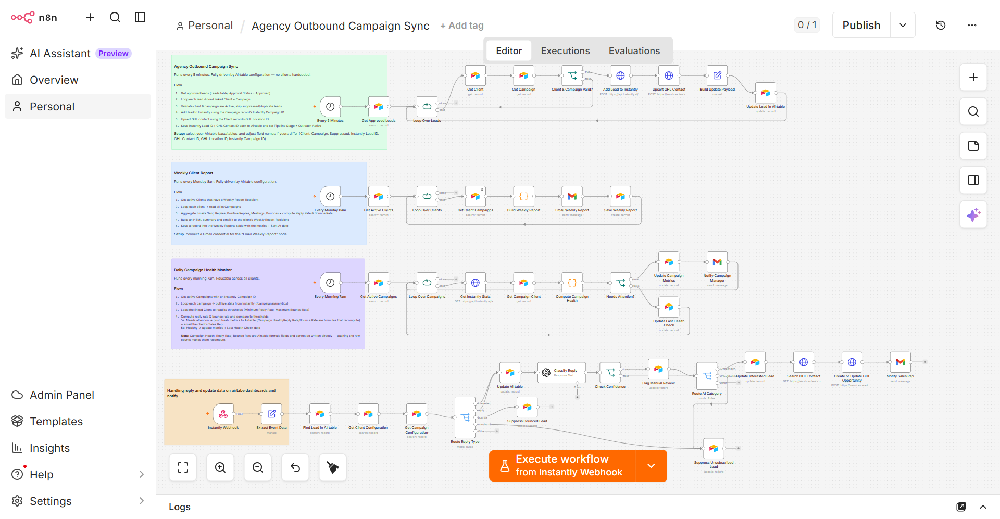

# AI-Driven Multi-Client Outbound Revenue Operations & Campaign Automation Engine



A B2B agency was spending hours manually managing client campaigns, lead routing, reply checks, CRM updates, campaign performance, and reporting. This n8n workflow automates the company's outbound campaign operations end to end — dynamically routing leads, classifying replies with AI, moving high-intent prospects into sales pipelines, suppressing invalid contacts, monitoring campaign health, and generating client-specific KPI dashboards and weekly performance reports.

---

## What It Does

### 1. Lead Sync (Every 5 minutes)
Pulls approved leads from Airtable, validates client and campaign status, pushes each lead into [Instantly](https://instantly.ai) for outreach, upserts a matching contact in [GoHighLevel (GHL)](https://www.gohighlevel.com), and writes back the external IDs and pipeline stage to Airtable — all without manual intervention.

### 2. Reply Processing (Webhook-triggered)
Receives real-time reply events from Instantly via webhook. Classifies each reply using GPT-4o-mini into `INTERESTED`, `NOT_INTERESTED`, `QUESTION`, `REFERRAL`, `OUT_OF_OFFICE`, `UNSUBSCRIBE`, or `OTHER`. High-intent replies automatically create a GHL Opportunity and notify the assigned sales rep via Gmail. Bounced and unsubscribed contacts are suppressed immediately.

### 3. Daily Campaign Health Monitor (Every morning at 7am)
Pulls live stats from Instantly for each active campaign, computes reply rate and bounce rate, and compares them against per-client thresholds stored in Airtable. Campaigns crossing a threshold trigger an alert email to the campaign manager and update the Airtable record.

### 4. Weekly Client Reports (Every Monday at 8am)
Aggregates campaign metrics per client, builds a formatted HTML report with per-campaign breakdowns, emails it to the client's designated recipient, and logs the report in Airtable for audit purposes.

---

## Tech Stack

| Tool | Role |
|---|---|
| **n8n** | Workflow automation engine |
| **Airtable** | Central database — Clients, Leads, Campaigns, Activity Log, Weekly Reports |
| **Instantly** | Cold email outreach & reply webhooks |
| **GoHighLevel (GHL)** | CRM — contact upsert & opportunity pipeline |
| **OpenAI (GPT-4o-mini)** | AI reply classification |
| **Gmail** | Automated report & alert delivery |

---

## Setup

### Prerequisites
- n8n instance (self-hosted or cloud)
- Airtable base with tables: **Clients**, **Leads**, **Campaigns**, **Activity Log**, **Weekly Reports**
- Instantly account with API access
- GoHighLevel account with API access
- Gmail OAuth2 credential configured in n8n
- OpenAI API key

### Import
1. Download `Agency Outbound Campaign Sync.json`
2. In n8n, go to **Workflows → Import from file** and select the JSON
3. Configure the credentials listed below
4. Update the Airtable base and table IDs to match your own base

### Credentials to configure

| Credential name in n8n | Type | Used for |
|---|---|---|
| Airtable account | Airtable OAuth2 | All Airtable read/write operations |
| Bearer Auth account | HTTP Bearer | Instantly API & GHL API calls |
| Gmail OAuth2 API | Gmail OAuth2 | Sending weekly reports and alerts |
| OpenAI API | OpenAI | Reply classification via GPT-4o-mini |

### Airtable schema

The workflow expects these field names. Rename to match or adjust the node mappings:

**Leads** — `Email`, `First Name`, `Last Name`, `Company`, `Phone`, `Approval Status`, `Suppressed`, `Instantly Lead ID`, `GHL Contact ID`, `Pipeline Stage`, `Campaign` (linked), `Client` (linked)

**Clients** — `Client Name`, `Status`, `GHL Location ID`, `GHL Pipeline ID`, `Interested Lead Stage ID`, `Minimum Reply Rate`, `Maximum Bounce Rate`, `Weekly Report Recipient`, `Assigned Sales Rep`, `Sales Rep Email`

**Campaigns** — `Campaign Name`, `Status`, `Instantly Campaign ID`, `Client` (linked), `Emails Sent`, `Replies`, `Positive Replies`, `Bounces`, `Meetings`, `Last Health Check`

**Activity Log** — `Reply Status`, `Last Event`, `Last Activity`, `Needs Manual Review`, `Reply Summary`, `Pipeline Stage`

**Weekly Reports** — `Client` (linked), `Week Start`, `Emails Sent`, `Replies`, `Positive Replies`, `Bounces`, `Meetings`, `Report Status`, `Sent At`

### Instantly webhook
Point your Instantly reply webhook to:
```
https://<your-n8n-domain>/webhook/instantly-reply
```

---

## Workflow Flows

```
[Every 5 min] → Get Approved Leads → Loop → Validate Client & Campaign
                                              ├─ Add Lead to Instantly
                                              ├─ Upsert GHL Contact
                                              └─ Update Airtable (IDs + stage)

[Webhook]     → Extract Event → Find Lead → Route by Event Type
                                              ├─ Reply  → Classify (AI) → Route by Category
                                              │                              ├─ INTERESTED → Update Lead → Create GHL Opportunity → Notify Sales Rep
                                              │                              └─ UNSUBSCRIBE → Suppress Lead
                                              ├─ Bounce → Suppress Lead
                                              └─ Unsub  → Suppress Lead

[Daily 7am]   → Get Active Campaigns → Loop → Pull Instantly Stats → Compute Health
                                                                        ├─ Needs attention → Update Metrics + Alert Campaign Manager
                                                                        └─ Healthy → Update Last Health Check

[Monday 8am]  → Get Active Clients → Loop → Get Client Campaigns → Build HTML Report
                                                                     ├─ Email to Client Recipient
                                                                     └─ Save to Weekly Reports table
```

---

## License

MIT
